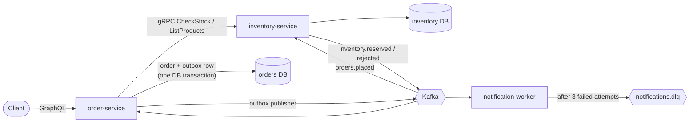

# EventMart: an event-driven order system

A small but production-style distributed system built with **TypeScript, GraphQL, gRPC, Apache Kafka and Docker**.
Customers place orders through a GraphQL API; stock is reserved asynchronously through Kafka events, and the
**transactional outbox pattern** guarantees an order is never saved without its event being published.



## Run it

Requirements: Docker with Compose v2.

```bash
docker compose up --build        # first build takes a few minutes
./scripts/demo.sh                # in another terminal (or use the GraphQL page at http://localhost:4000)
```

Example mutation:

```graphql
mutation {
  placeOrder(input: { customerId: "megha", items: [{ sku: "KB-001", quantity: 2 }] }) {
    id
    status # PENDING now, CONFIRMED a moment later
    totalCents
  }
}
```

Seeded SKUs: `KB-001`, `MS-002`, `MN-003`, `HB-004`, `ST-005` (query `products` to see stock and prices).

## How a request flows

1. **GraphQL `placeOrder`** (order-service) validates the input and calls inventory-service over **gRPC** (`CheckStock`)
   for fast feedback and authoritative prices.
2. The order and an **outbox row** are written in **one PostgreSQL transaction**. Kafka is never called inside it.
3. The **outbox publisher** reads unpublished rows (`FOR UPDATE SKIP LOCKED`), publishes them to Kafka, and only then
   marks them published. A crash in between causes a re-send, so delivery is **at-least-once**.
4. **inventory-service** consumes `orders.placed`, reserves stock atomically, and publishes `inventory.reserved` or
   `inventory.rejected`.
5. order-service consumes the result and moves the order to `CONFIRMED` or `REJECTED`.
6. **notification-worker** also consumes the result and "sends" a notification, with retries and a dead-letter topic.

## Design decisions

| Problem | Solution |
|---|---|
| Saving an order and publishing an event can't be atomic across DB and Kafka (dual write) | Transactional outbox: both writes go to the same DB transaction, a relay publishes later |
| Kafka delivers at-least-once, so duplicates happen | Inventory records every handled `eventId` in `processed_events`; a duplicate returns the stored outcome and never touches stock twice |
| Crash after the stock commit but before publishing the result | The redelivered event finds its stored outcome and re-publishes it |
| Two orders competing for the same SKUs could deadlock | Rows are updated in SKU order inside one transaction |
| Stock check at order time can go stale | `CheckStock` is only advisory; the async reservation is authoritative and can reject the order |
| Flaky downstream provider | Retry with exponential backoff (3 attempts), then publish to `notifications.dlq` |
| Services sharing a database becomes hidden coupling | One database per service (`orders`, `inventory`) |
| N+1 queries in GraphQL | Orders and their items are fetched in a single `json_agg` query |

## Things to try

```bash
# Flaky notification provider (FAIL_RATE=0.3): watch retries and the dead-letter topic
docker compose logs -f notification-worker

# Inventory down: order-service returns SERVICE_UNAVAILABLE instead of hanging (3 s gRPC deadline)
docker compose stop inventory-service

# Events pile up in Kafka while a consumer is down, then are processed on restart
docker compose stop inventory-service && ./scripts/demo.sh; docker compose start inventory-service
```

## Project layout

```
proto/inventory.proto            gRPC contract shared by both services
services/order-service           GraphQL API, outbox publisher, Kafka consumer, gRPC client
services/inventory-service       gRPC server, idempotent Kafka consumer, stock reservation
services/notification-worker     Kafka consumer, retry/backoff, DLQ
docker-compose.yml               Postgres + Kafka (KRaft, no ZooKeeper) + 3 services
.github/workflows/ci.yml         typecheck + unit tests per service, docker build
```

## Development

```bash
cd services/order-service && npm ci && npm run typecheck && npm test
```

## Known limitations / next steps

- The result event in inventory-service is published directly (made safe by the idempotent re-publish described above).
  The next step would be a second outbox there.
- notification-worker de-duplicates in memory; production would use Redis or a database table.
- No authentication on the GraphQL API; gRPC runs without TLS (fine inside a private Docker network).
- Single Kafka broker and replication factor 1: a demo setup, not a production topology.
- Next steps: Kafka-backed integration tests with Testcontainers, OpenTelemetry tracing, a GraphQL subscription for order status.
